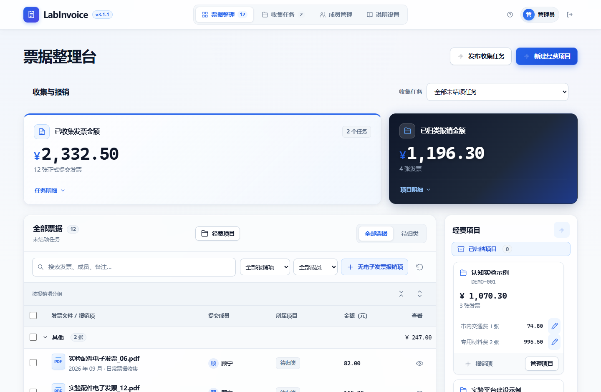
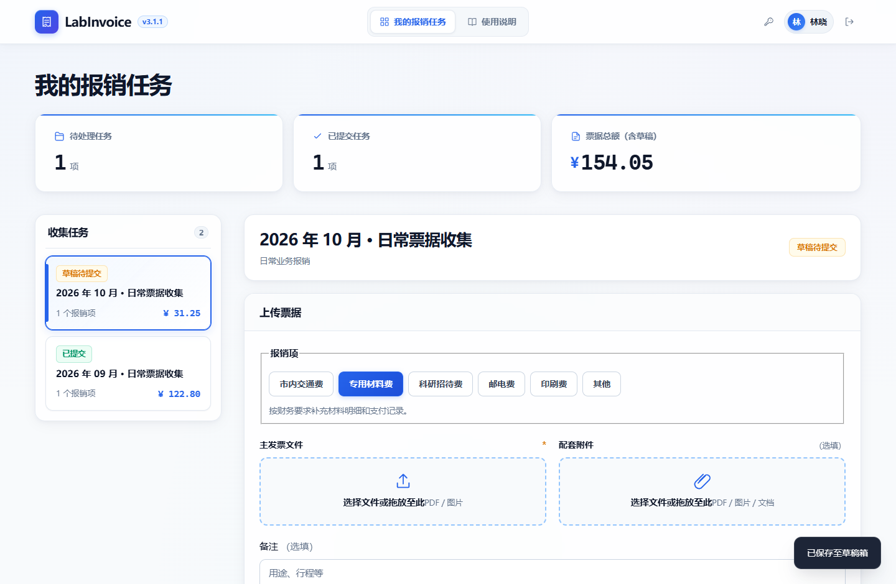

# LabInvoice

**给实验室和小团队的发票收集与报销整理工具。**

把发票、行程单和支付凭证收进一个工作台。成员按任务提交，管理员按经费项目核对、归类，再下载原始票据、CSV 汇总或打印用 PDF。

*Self-hosted invoice collection and reimbursement preparation for research labs and small teams.*

[快速启动](#快速启动) · [体验演示](#体验演示) · [使用指南](docs/USAGE.md) · [部署与升级](docs/DEPLOYMENT.md) · [贡献](CONTRIBUTING.md)

[](LICENSE)
[](#快速启动)
[](https://github.com/wang-jingcheng/LabInvoice/stargazers)



*演示数据中的管理员票据整理台。*

## 适合哪些工作

| 你要做的事 | LabInvoice 的做法 |
| --- | --- |
| 月底向实验室成员收票 | 创建收集任务、指定成员，查看待填写、草稿中和已完成状态 |
| 一起提交发票与证明材料 | 按报销项保存草稿，分批追加 PDF、图片和附件，核对后正式提交 |
| 按经费项目整理一批票据 | 按任务、成员和报销项筛选，勾选或拖放归类，逐张检查金额 |
| 登记劳务费或只有纸质发票的报销 | 添加无电子发票报销项，同步计入任务和项目汇总 |
| 向财务提交材料 | 下载原件及 CSV 明细，或选择主票和附件合并成 PDF |
| 在自己的服务器保存资料 | Flask 应用配合 SQLite 与本地文件目录，无需单独部署数据库服务 |

<details>
<summary>查看成员上传页面</summary>



</details>

## 快速启动

需要 **Python 3.10 或以上**，建议使用 Python 3.12。首次启动会创建空白工作区。

```bash
git clone https://github.com/wang-jingcheng/LabInvoice.git
cd LabInvoice
python3 -m venv .venv
source .venv/bin/activate
python -m pip install -r requirements.txt
export LABINVOICE_DATA_DIR="$PWD/data"
export LABINVOICE_ADMIN_PASSWORD="$(python -c 'import secrets; print(secrets.token_urlsafe(18))')"
printf '本次管理员密码 %s\n' "$LABINVOICE_ADMIN_PASSWORD"
python app.py
```

<details>
<summary>Windows PowerShell 命令</summary>

```powershell
git clone https://github.com/wang-jingcheng/LabInvoice.git
cd LabInvoice
python -m venv .venv
.\.venv\Scripts\python.exe -m pip install -r requirements.txt
$env:LABINVOICE_DATA_DIR = Join-Path $PWD.Path "data"
$env:LABINVOICE_ADMIN_PASSWORD = & .\.venv\Scripts\python.exe -c "import secrets; print(secrets.token_urlsafe(18))"
Write-Output $env:LABINVOICE_ADMIN_PASSWORD
.\.venv\Scripts\python.exe app.py
```

</details>

- [管理员入口](http://127.0.0.1:5000/admin)使用刚生成的密码。添加成员并为他们发布第一个收集任务。
- [成员入口](http://127.0.0.1:5000/)可注册或登录已有账号。分配到任务后即可上传票据。
- [使用说明](http://127.0.0.1:5000/help)可直接打开。管理员可以编辑 Markdown、插入图片并预览。

## 体验演示

想先看一遍完整流程，可以启动隔离演示。它会自行生成任务、经费项目和示例 PDF。

```bash
python -m pip install -r requirements-dev.txt
python scripts/preview_server.py
```

| 入口 | 演示凭据 |
| --- | --- |
| [成员工作台](http://127.0.0.1:8791/) | 账号 `demo`，密码 `demo-only` |
| [管理工作台](http://127.0.0.1:8791/admin) | 密码 `preview-admin-2026` |

演示监听本机，数据保存在独立的 `.test-data/preview/`。正常工作区使用单独设置的管理员密码。

## 从收集到交付

1. 管理员给成员派发任务，成员按报销项上传主发票和附件，在草稿中逐张核对金额后提交。
2. 管理员结束收集后，在整理台把票据关联到经费项目，核对报销项与金额，补录无电子发票的报销。
3. 核对项目与成员合计后下载材料。收集任务结项后，可从归档项目继续查询或导出。

系统从 PDF 的文本层尝试提取票面金额。图片、扫描件和未识别的 PDF 在提交前需人工补填。项目 ZIP 包含原件、CSV 和归档清单，合并 PDF 可按需选择能转换的附件。财务审核和付款沿用所在单位的流程。 [文件支持与操作细节](docs/USAGE.md)

## 部署与数据

| 环境变量 | 用途 |
| --- | --- |
| `LABINVOICE_DATA_DIR` | 数据目录。已有部署省略此项时沿用程序目录，建议新部署显式指定 |
| `LABINVOICE_ADMIN_PASSWORD` | 设置管理员密码后开放后台登录 |
| `LABINVOICE_SECRET_KEY` | 可选的会话签名密钥。未设置时，在数据库中持久化自动生成的密钥 |
| `LABINVOICE_HOST` / `LABINVOICE_PORT` | 直接运行 `app.py` 的监听地址和端口，默认 `127.0.0.1:5000` |

部署到服务器时，可使用 Gunicorn 和 HTTPS 反向代理。已有版本升级前应停服，备份 `labinvoice.db`、`uploads/` 和已有的 `.trash/` 后，再更新程序并启动自动迁移。 [部署指南](docs/DEPLOYMENT.md) · [升级与回滚](docs/UPGRADE.md)

## 项目结构

```text
app.py        页面路由、登录、上传和管理 API
storage.py    SQLite 迁移、历史票据适配与汇总
expenses.py   无电子发票报销
exports.py    原件 ZIP、CSV 与合并 PDF
guide.py      站内使用说明
templates/    Flask 页面模板
static/       本地样式、交互与图标
scripts/      隔离演示、备份、迁移与浏览器测试入口
tests/        后端测试和浏览器测试
docs/         使用、部署与升级指南
vendor/       随附的 Mistune Markdown 解析器及其许可证
```

## 贡献与许可

欢迎分享你们的收票流程、报告问题或改进文档与代码。如果 LabInvoice 帮你少整理一轮表格或聊天附件，欢迎给项目点个 **Star**。 [提交反馈](https://github.com/wang-jingcheng/LabInvoice/issues/new/choose) · [贡献指南](CONTRIBUTING.md) · [版本记录](CHANGELOG.md)

项目采用 [MIT 许可证](LICENSE)。随附的 Mistune 采用 [BSD-3-Clause](vendor/MISTUNE-LICENSE)。
